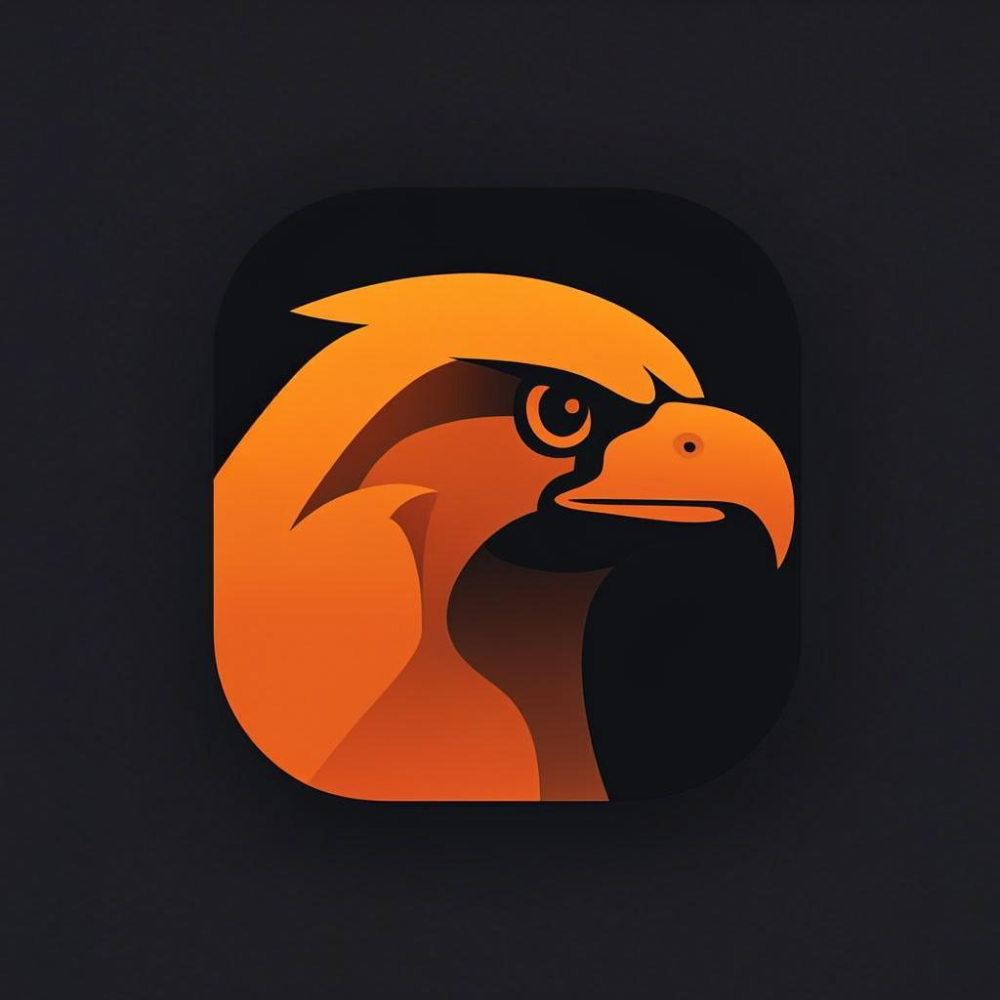

<p align="center">
  
</p>

<h1 align="center">Peregrine</h1>

<p align="center">
  <strong>A fast, native-feeling AI console for iOS &amp; Android —<br>bring your own endpoint, keep every byte on your device.</strong>
</p>

<p align="center">
  Expo SDK 57 · React Native 0.86 · expo-router · TypeScript strict · Reanimated 4 · FlashList · TanStack Query · Zustand · MMKV
</p>

---

## Why

Every AI chat app wants your account, your history, and your attention.
Peregrine is the opposite: a **bring-your-own-endpoint console** that speaks
the OpenAI-compatible `/v1` protocol — point it at Ollama on your own machine,
a self-hosted gateway, or a cloud provider, and nothing ever touches a
Peregrine server (there isn't one). The API key lives in the Keychain,
conversations live in MMKV on device.

It is also a deliberate showcase of a rigorous mobile build bar — the
[appllama app-design skill](https://github.com/Appllama/appllama-skills)
(see [docs/DESIGN.md](docs/DESIGN.md) for the law-by-law compliance matrix).

## Features

- **Streaming chat** — SSE deltas rendered token by token, abortable mid-flight, with a graceful non-streaming fallback
- **Bring your own endpoint** — any `/v1`-speaking API: Ollama, OpenRouter, OpenAI, self-hosted gateways
- **Model browser** — live `/v1/models` via TanStack Query: shape-matched skeletons, inline errors, pull-to-refresh, native search bar
- **Native by default** — SF Symbols on iOS / Material icons on Android, system Switch & Slider, large-title collapse, native search, haptics as punctuation
- **One-way-door onboarding** — guarded with `Stack.Protected`: once an endpoint is set, back can never re-enter it
- **Light + dark from day one** — semantic color tokens resolved per theme, no hard-coded hexes in screens
- **Zero network beyond your endpoint** — no analytics, no telemetry, no accounts

## Architecture

```
src/
├── app/                  # expo-router routes
│   ├── _layout.tsx       # providers + Stack.Protected one-way door
│   ├── onboarding.tsx    # endpoint setup (guarded)
│   ├── (tabs)/           # chats · models · settings
│   ├── chat/[id].tsx     # streaming thread (inverted FlashList)
│   ├── model/[id].tsx    # model detail (push)
│   └── apikey.tsx        # modal, Keychain-backed
├── components/           # pressables, bubbles, composer, symbols
└── lib/
    ├── api.ts            # plain-fetch /v1 client + SSE async generator
    ├── store.ts          # Zustand: settings + chat, persisted to MMKV
    ├── storage.ts        # MMKV instance + SecureStore key vault
    ├── theme.ts          # semantic palette, 4pt rhythm, shape lock
    ├── motion.ts         # one spring vocabulary (SNAP/POP) + ease-out
    ├── haptics.ts        # tick / tap / warn / success / error
    └── format.ts         # 1.4M · 38k · 312ms — product-grade formatting
```

**State split** (the boring kind, on purpose): server state in TanStack
Query, client state in two narrow Zustand stores persisted to MMKV,
ephemeral UI state local to components. The composer input is uncontrolled —
keystrokes never re-render the conversation list.

**Streaming** is a hand-rolled SSE async generator over plain `fetch` —
no SDK weight, works against any conformant endpoint, abortable via
`AbortController`, first token lands as fast as the wire allows.

## Run it

```bash
npm install
npx expo prebuild          # generates native projects (dev build, not Expo Go)
npx expo run:ios           # or: npx expo run:android
```

Typecheck only:

```bash
npx tsc --noEmit
```

> Peregrine targets a development build (MMKV and the keyboard controller
> need native code). Expo Go is not a target — release-profile jank is
> invisible in it anyway.

Point it at a local Ollama (`http://localhost:11434`), or any OpenAI-compatible
gateway, and chat.

## Design bar

Screens are built against the
[appllama app-design skill](https://github.com/Appllama/appllama-skills):
native fidelity laws, navigation semantics (push vs replace, modal vs sheet,
one-way doors), anti-slop discipline (one accent, one grey family, a stated
radius scale, no emoji in chrome), and a motion budget that lives on the UI
thread. The full checklist: [docs/DESIGN.md](docs/DESIGN.md).

## Roadmap

- [ ] System-prompt per conversation
- [ ] Markdown rendering in assistant bubbles
- [ ] Context menus (zeego) for conversation rows
- [ ] Token usage per reply, tabular numerals everywhere

## License

[MIT](LICENSE) — © 2026 Godde3s. "Appllama" is a trademark of its owner;
this project only references the public skill as a design methodology.
